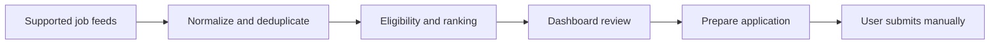

# Local AI Job Search & Application Agent

## Portfolio overview

**Job discovery and review workflow:** A local Python/FastAPI app for source-aware vacancy collection, eligibility checks, explainable matching and human-reviewed application preparation.



Restricted boards and unverifiable openings require manual review. Do not interpret the project as autonomous portal submission, email sending, or a completed Command Center. See [source coverage](specs/source-platform-matrix.md).

---

## Milestone 2B: local recommendation intelligence

The dashboard now includes a versioned candidate profile, deterministic hard eligibility gates, cached offline semantic matching, explainable hybrid rankings and an optional zero-budget-by-default LLM adapter. Employment skills, AI project skills and learning skills remain separate; no professional AI tenure is inferred. A PDF/DOCX resume can be referenced locally under ignored `data/resumes/`, but it is never automatically edited or treated as verified facts.

Refresh recommendations from the dashboard or call `POST /api/recommendations/refresh`. The bundled deterministic embedding provider requires no model download or paid API. Recommendation scores order jobs; they are not hiring probabilities. See `specs/m2b-design.md` and `docs/m2b-evaluation.md`.

Milestone 2A adds live discovery from permitted public Greenhouse and Lever job-listing APIs to the local **manual** application tracker. File imports, explained deterministic matching and SQLite decisions from Milestone 1 remain available. It does not send applications, call an LLM, scrape protected portals or access accounts. Files in `samples/` are fictional; fetched employer listings are clearly marked as live public listings.

## Windows setup

Python 3.12.10 was used for verification. Use the project `.venv` executable directly; activation and execution-policy changes are unnecessary.

```powershell
Set-Location <path-to-your-checkout>
# Dependencies are already installed. To reproduce them in an existing .venv:
.\.venv\Scripts\python.exe -m pip install -r requirements.lock.txt
.\.venv\Scripts\python.exe -m pip install -e . --no-deps
```

To recreate a virtual environment in a fresh checkout only:

```powershell
py -3.12 -m venv .venv
```

The lock contains the exact runtime and test dependency versions used in validation. The editable local package is installed separately. Project metadata lives in `pyproject.toml`.

## Run

```powershell
.\.venv\Scripts\python.exe -m job_agent
```

Open **http://127.0.0.1:8000/**. The machine-readable API contract is at `/openapi.json`; CDN-based Swagger/ReDoc pages are disabled to keep the app self-contained. Stop with Ctrl+C. Run from the workspace root: the default database is `data/jobs.sqlite3`, with SQLite WAL companion files. This ignored folder holds local personal data; protect it and back it up with SQLite's backup API or while the server is stopped. Do not expose the service publicly or override binding to `0.0.0.0`. There is no login/authentication; other local processes can access it.

If port 8000 is occupied, use `.\.venv\Scripts\python.exe -m job_agent --port 8001` and open **http://127.0.0.1:8001/**. This was the port used for live verification on this machine; no existing service was stopped.

## Use

1. In **Import opportunities**, upload `samples/jobs.json`; upload it again to verify idempotency. Upload `samples/jobs.csv` to add one new fictional job and another source reference to an existing one.
2. Search/filter jobs, open a title for matching explanations, source references and status history, and shortlist jobs.
3. Change manual statuses as your search progresses. Even **APPROVED** and **SUBMITTED** are tracking labels; they never authorize an action or verify that anything was submitted.
4. Expand **Matching preferences** to update titles, skills, locations, modes, exclusions and optional experience. Changes rescore all stored jobs. Default skills are preferences, not claimed expertise. Unknown candidate experience is not inferred.
5. Review recent activity. Audit stores metadata, never uploaded descriptions or credentials.

## Import contract

Upload UTF-8 JSON arrays or CSV with headers. Required fields: `source`, `company`, `title`, `location`. Optional fields: `source_job_id`, `work_mode` (`remote`, `hybrid`, `onsite`, `unknown`), `description`, `skills`, `application_url`, `min_experience`, `max_experience`, `is_sample`. JSON skills are an array; CSV skills use semicolons. Blank optional CSV cells use defaults. Maximum 2 MiB and 1,000 records. Unknown fields and invalid field values reject the row. Malformed documents reject the entire file before job writes; valid rows in a mixed import commit together with a report of invalid rows.

Application URLs must be HTTP(S), without embedded credentials or sensitive query keys. Tracking `utm_*` parameters and fragments are removed. Do not import secrets or private application documents. Free text is untrusted and displayed as plain text.

Identity hashes normalized company/title/location/work mode; source IDs and URLs provide additional identity evidence. Reimports do not replace details or status. Cross-source copies retain provenance. Reused identifiers with different identity are reported as `identity_conflict`; changed descriptions, skills, experience or sample flags as `content_conflict`. Review these conflicts manually. Deduplication is conservative and cannot distinguish all repeated vacancies; live connector identity and update policies are deferred. Include country in locations (for example `Bengaluru, India`) because geography matching uses explicit text rather than geocoding. Missing fields lower scores or produce unknowns. Scores are heuristic fit, not interview probabilities.

## Test

```powershell
.\.venv\Scripts\python.exe -m pytest -q --tb=short
.\.venv\Scripts\python.exe -m coverage html
.\.venv\Scripts\python.exe -m pip check
```

Tests use temporary databases. Coverage includes all `job_agent` Python modules, requires at least 90%, and emits `coverage.xml`; HTML report goes to ignored `htmlcov/`. JavaScript is outside Python coverage. See `specs/verification.md` for actual results, commands, known warnings and browser verification limits.

While the server is running, an optional live smoke check is `.\.venv\Scripts\python.exe scripts\verify_local.py --port 8001`. It imports the fictional fixtures and marks the sample AI Application Engineer job as SHORTLISTED. It is not a read-only check.

## Project map

- `specs/`: requirements, architecture, security/approvals, acceptance criteria, execution plan, decisions, connector contract and verification.
- `job_agent/`: models, matching, file connectors, database, service, HTTP app, launcher, future approval fingerprint, and static dashboard.
- `samples/`: fictional JSON/CSV fixtures.
- `tests/`: normalization, matching, imports, API, persistence, audit, transactions and safety checks.
- `requirements.lock.txt`: exact installed dependency versions.

Milestone 2B: optional provider-independent LLM evaluation, reviewed document generation, richer skill-evidence records and immutable approval packages with explicit revocable grants. Approved submission adapters belong to a separately authorized future milestone. Account access, paid services and real submissions require separate authorization. No GitHub PR is created.

## Live discovery (Milestone 2A)

The dashboard's **Run discovery** button returns a run ID immediately and polls its status. Source health, last success, cooldown and enable/disable controls appear above the opportunities. Filter by role category, priority, source, listing type and fit; sort by fit or last-seen. Details show original employer links, eligibility, seniority and fit explanations. Opening a link never sends an application.

Verified public seed sources on 2026-10-10: [Netomi on Lever](https://jobs.lever.co/netomi/) and [Prophecy on Greenhouse](https://job-boards.greenhouse.io/prophecysimpledatalabs). This small registry is not a comprehensive India job search. Prophecy's three current API records are US listings and are flagged ineligible for India; Netomi provides the India-eligible listings in the verified run. A published listing is not a guarantee of availability or employment eligibility; review original requirements.

Configuration: `config/discovery.json`. Add a source with a unique `id`, `provider` (`greenhouse`/`lever`), exact publicly verified `board`, company display name, optional `region` (`global`/`eu` for Lever) and `enabled`. Do not guess employer tokens. Provider endpoints are constructed from symbolic IDs and fixed HTTPS hosts. No credentials are required. Greenhouse fetches its complete published board, Lever paginates with skip/limit; this is full-board fetching with local change detection, not a provider incremental API.

Registry flags persist in SQLite. Existing board identities are immutable; add a new ID and disable an old source to change boards. Editing JSON does not reset dashboard toggles on restart. Apply changes explicitly:

```powershell
# Configure sources without fetching:
.\.venv\Scripts\python.exe -m job_agent.discover --sync-sources --setup-only
# Manual discovery, independent of the dashboard/VS Code/Codex:
.\.venv\Scripts\python.exe -m job_agent.discover
```

Optional CLI arguments: `--config <path>`, `--db <path>`. Run from the workspace root or use absolute paths. Run exit codes: 0 completed, 1 partial/failed, 2 overlapping run skipped. Per-source failures do not abort healthy sources. Settings default to 10-second request timeout, 2 retries, 1-hour per-source cooldown, sequential concurrency 1, 20 requests/run, 120-second runtime, 8 MiB decompressed response and 5,000 records/source. Larger concurrency is deliberately unsupported. Honor rate limits and provider cache headers; do not repeatedly force retries.

Metrics persist in SQLite and are available through `/api/discovery/latest`, `/api/discovery/runs/{id}` and `/api/sources`. They include starts/finishes/duration, requests, HTTP errors, fetched records, new/updated/unchanged jobs, new cross-source duplicates, rejected records, retries, failed/skipped sources and checkpoints. Completed 304 validations count known listings unchanged with zero fetched bodies. These are listing counts per source, so an unchanged cross-source copy may contribute twice.

Source IDs and content signatures preserve first/last-seen and last-changed timestamps. Unchanged records skip normalization/evaluation. Updates preserve statuses and history. Natural identity detects cross-source copies, but contradictory descriptions/identifiers are rejected for review. The first accepted live source owns canonical updates; secondary snapshots preserve provenance. Removed listings stay as historical records with their last-seen time; automatic closure is deferred.

Live matching uses the separate **Live search background and skill evidence** panel: approximately 7 software years, 3.5 backend years, frontend strengths and additional/developing areas. This preserves original file-import preferences and user edits. Live matching also shares work-mode/exclusion settings. Skills are self-reported preferences, not verified resume assertions; individual academic/project/professional evidence remains unspecified. Explicit required/preferred/negated requirements are separated; uncertain extraction stays unknown. Remote/global alone does not establish India employment eligibility. Junior or level-I scope receives seniority review; AI engineering transition roles can still score highly. AI words alone do not promote product-manager roles.

## Database migration

Stop application/discovery processes before the first upgrade. The application upgrades schema version 1 to 2 atomically and retains a SQLite snapshot at `data/jobs.sqlite3.pre-v2.bak`. Existing jobs, IDs, profile edits, statuses, history and audit remain intact. New tables store sources, discovery runs/source metrics, a lease, and live background. Existing tables gain classification, timestamps, public listing URL and source snapshots/hashes. Failed migrations roll back. A successful upgrade is one-way; restoring the backup requires stopping processes and explicitly replacing the database, which discards subsequent state. No restore/deletion was performed.

## Daily Windows schedule

Default schedule is **08:00 India Standard Time (UTC+05:30)**, independent of VS Code/Codex. No task has been registered. Preview the exact task without changing settings or registering anything:

```powershell
.\.venv\Scripts\python.exe -m job_agent.scheduling
```

Only after explicitly approving creation of a persistent Windows task, register/update the same project task idempotently:

```powershell
.\.venv\Scripts\python.exe -m job_agent.scheduling --register
# Optional catch-up when the machine becomes available:
.\.venv\Scripts\python.exe -m job_agent.scheduling --register --catch-up
```

Use `--india-time HH:MM` or `--task-name <name>` to customize. XML StartBoundary carries the explicit +05:30 offset, following [Microsoft's documented time-zone format](https://learn.microsoft.com/en-us/windows/win32/taskschd/trigger-startboundary). The task launches the absolute project Python path, uses the workspace as working directory, runs with least privilege for the current logged-in user, stores no password, and ignores overlapping scheduler instances. The SQLite lease also prevents overlap with dashboard/CLI runs. Other task names are never forcibly overwritten.

If the machine is off/asleep or the user is logged out at 08:00, the default misses that day's run. `--catch-up` enables StartWhenAvailable after availability and an interactive user session; wake timers/unattended logged-out execution are not enabled. Actual task registration and execution are not verified, because they require separate approval. Registration may require Task Scheduler permissions under local organizational policies. Check outcomes in persisted run metrics.

An optional PowerShell implementation is `scripts/setup-discovery-task.ps1` (preview by default, `-Register`, `-CatchUp`). On this machine execution policy blocks `.ps1`; do not change policies for this project. The supported Python planner uses native Task Scheduler XML/schtasks instead and its preview was executed successfully.

## Milestone 2A validation and limitations

Run the existing pytest command above: the suite includes mocked provider parsing, pagination/caching, errors/retries, response budgets, registry controls, migration rollback, change detection, statuses, background APIs, lease recovery, ranking and scheduling plans. Automated tests use mocked HTTP only. Windows task registration is mocked in tests; no task is created.

Live integration utilities (perform public GETs and write local listings/metrics): `.\.venv\Scripts\python.exe scripts\verify_discovery.py` followed by the same command with `--repeat`. These restrict verification to 6 requests and 60 seconds per run and preserve baseline manual statuses. The first successful run discovered 26 real jobs; the repeat reported 26 unchanged with no new jobs. See `specs/verification.md` for final categories, runtime, exact coverage and errors.

Known limits: two seed employers, conservative geography/requirement extraction, no automatic removal/closure, first-source ownership of conflicting updates, 1,000-result list cap and no full interactive browser QA. The service remains unauthenticated and loopback-only. No personal accounts, real approvals/submissions, persistent task installation, paid services, security-policy changes or PRs were performed.


## Milestone 2A.1
The dashboard now exposes evidence-backed India eligibility (`ELIGIBLE`, `INELIGIBLE`, `UNKNOWN`), seniority, listing activity, employer/source filters, freshness sorting, source verification and expanded run metrics. The verified registry is in `config/discovery.json`. Browser QA can be repeated after installing `.[browser]` with `python scripts/verify_browser.py` while the app runs on port 8011. Scheduling remains unregistered.


## Milestones 2A.2 and 2A.3
Discovery now fetches up to four sources concurrently and serializes database writes. The dashboard uses 50-row server-side pages and filters publication freshness, normalized preferred locations, experience overlap and required skills. It defaults to the last 48 hours and keeps older/unknown-date jobs available. Remote OK and We Work Remotely are the only new direct feeds; see `specs/source-platform-matrix.md` for restricted/manual alternatives. Times display in Asia/Kolkata. Scheduling remains unregistered.

